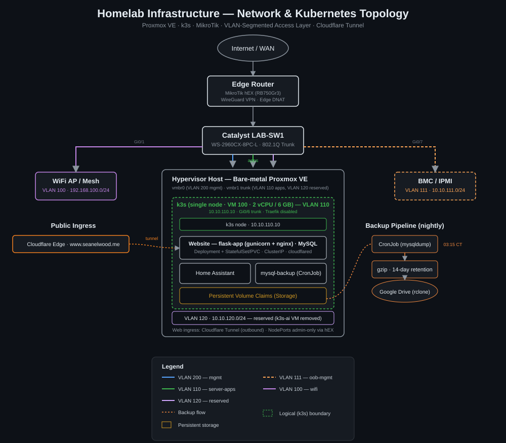

# Homelab

Personal homelab running Proxmox VE with a single-node k3s cluster that hosts my website and serves as the base for network traffic generation and analysis.

---

## Infrastructure Diagram



---

## Hardware

### Hypervisor Host
- **Chassis:** 1U — IPC-G1320M-BK
- **Motherboard:** ASRock Rack E3C232D4U
- **CPU:** Intel Core i7-7700K (4C/8T)
- **RAM:** 32GB DDR4 Non-ECC
- **Storage:** 100% Flash (LVM-thin `data-vms` for VM disks)

### Workstations
- **Admin:** Lenovo ThinkPad — Debian/Ubuntu (192.168.100.234)
- **Gaming:** Bazzite OS

---

## Network

### Devices
- **Edge Router:** MikroTik hEX (RB750Gr3) — native WireGuard VPN, inter-VLAN firewall
- **Access Switch:** Cisco Catalyst WS-2960CX-8PC-L "LAB-SW1" — 802.1Q trunk

### VLAN Layout

| VLAN | Subnet | Purpose | Switch port |
|---|---|---|---|
| 200 | 10.10.200.0/24 | Proxmox management (`vmbr0`, host 10.10.200.4) | Gi0/8 |
| 111 | 10.10.111.0/24 | OOB / BMC | Gi0/7 |
| 110 | 10.10.110.0/24 | Server apps — k3s node 10.10.110.10 (`vmbr1` trunk) | Gi0/6 |
| 120 | 10.10.120.0/24 | Reserved (former isolated AI VM) | Gi0/6 (`vmbr1` trunk) |
| 100 | 192.168.100.0/24 | WiFi (eero mesh) | Gi0/1 |

---

## Proxmox

| VMID | Name | vCPU | RAM | Disk | Network |
|---|---|---|---|---|---|
| 100 | `k3s` | 2 | 6 GB (no balloon) | 200 GB thin, discard on | `vmbr1` tag 110 |
| 110 | `mgmt` | 2 | 2 GB | 32 GB thin, discard on | `vmbr0` (VLAN 200), 10.10.200.10 |

QEMU guest agent is enabled on both VMs. MCP servers run on `mgmt` (see [`mgmt/`](mgmt/README.md)), so restarting VM 100 no longer cuts off management access.

---

## k3s Cluster

Single node on VM 100. k3s config (`/etc/rancher/k3s/config.yaml`):

```yaml
disable:
  - traefik   # no Ingress in use; web traffic arrives via Cloudflare Tunnel
```

### Website (`web` namespace)

| Component | Kind | Image | Notes |
|---|---|---|---|
| flask-app | Deployment (gunicorn + nginx sidecar) | `ghcr.io/selw-prog/flask-app:sha-<commit>` | Built by GitHub Actions in [flask-app](https://github.com/selw-prog/flask-app); bump the tag to roll out |
| mysql | StatefulSet + PVC | `mysql:8.0` | App DB + `tornado_events` |
| cloudflared | Deployment | `cloudflare/cloudflared` | Outbound tunnel; serves [www.seanelwood.me](https://www.seanelwood.me) |
| mysql-backup | CronJob | `mysql:8.0` + `rclone/rclone:1` | Nightly 03:15 CT `mysqldump --all-databases` → `gdrive:WebsiteBackups/mysql`, 14-day retention |
| home-assistant | StatefulSet + PVC | `ghcr.io/home-assistant/home-assistant:stable` | NodePort 30003 |

### MCP (`mcp` namespace)

| Component | Image | NodePort | Notes |
|---|---|---|---|
| proxmox-mcp | `supercorp/supergateway` + `proxmox-mcp-server` | 30081 | PVE API token `claude@pve!mcp`; write access enabled. hEX restricts 30081 to the admin workstation. |

### Secrets

Secrets are never committed (`secret*.yaml` is gitignored). Required, applied manually:

| Namespace | Secret | Keys |
|---|---|---|
| web | `flask-app-secret` | `DB_USER`, `DB_PASSWORD`, `DB_HOST`, `DB_PORT`, `DB_NAME`, `SECRET_KEY` |
| web | `mysql-secret` | `MYSQL_ROOT_PASSWORD`, `MYSQL_USER`, `MYSQL_PASSWORD`, `MYSQL_DATABASE` |
| web | `cloudflared-secret` | tunnel token |
| web | `ghcr-pull-secret` | dockerconfigjson for GHCR |
| mcp | `proxmox-mcp-creds` | `PROXMOX_HOST`, `PROXMOX_USER`, `PROXMOX_TOKEN_NAME`, `PROXMOX_TOKEN_VALUE` |

Backups use the node's rclone config at `/home/sean/.config/rclone` (hostPath).

### Archived

Minecraft servers and the Vector / VictoriaMetrics / VictoriaLogs / Grafana stack were removed on 2026-11-19. Minecraft manifests and restore notes: [`k3s/archive/minecraft`](k3s/archive/minecraft/README.md). The observability manifests remain in git history.
